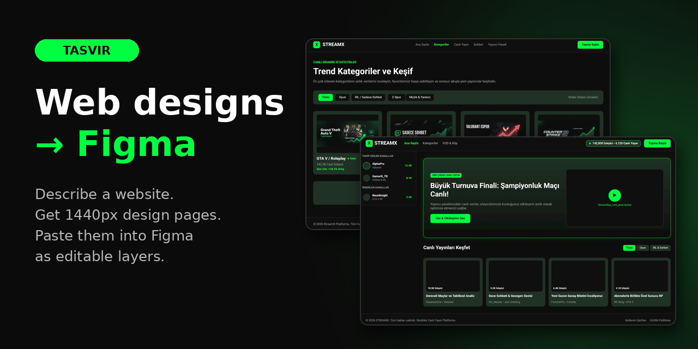
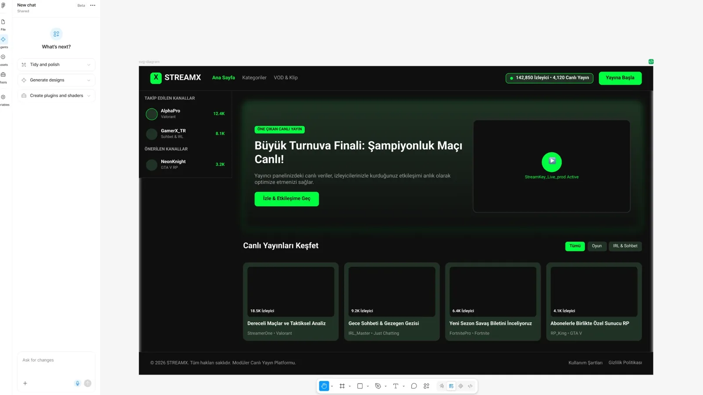
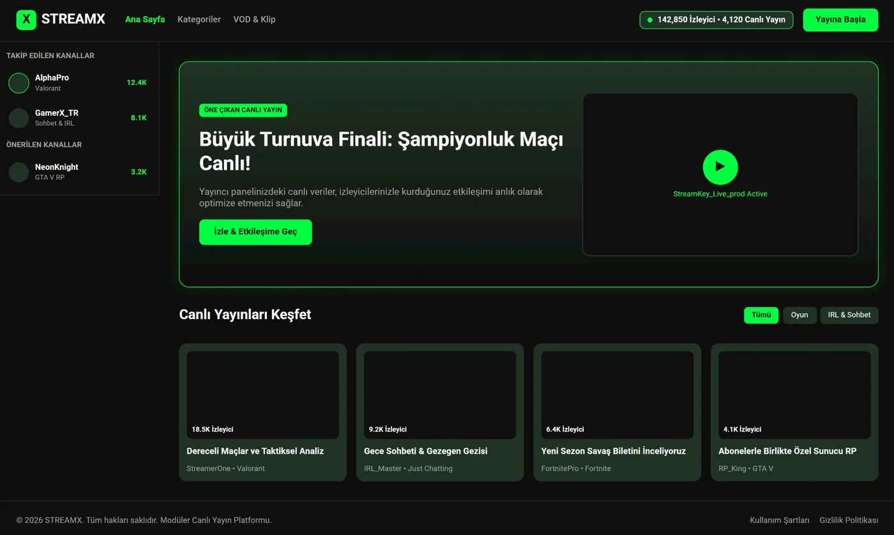
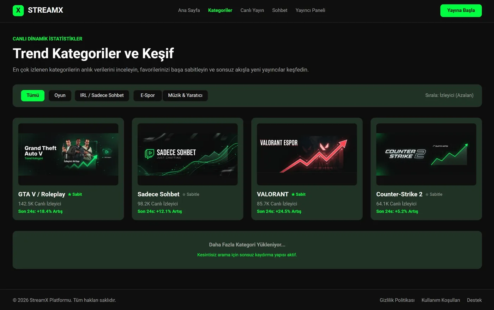
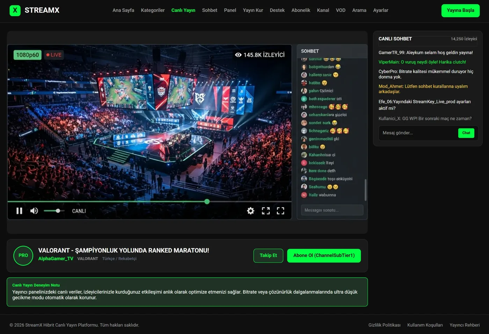
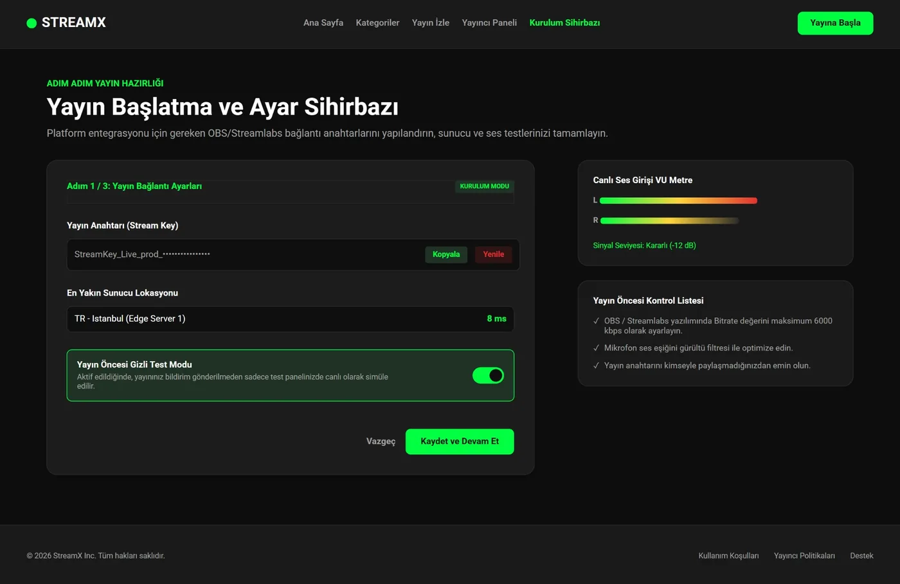

<div align="center">



# Web Designs → Figma

### Describe a website. Tasvir designs every page at 1440px. Paste them into Figma as editable layers.

[](https://app.tasvir.ai?src=github&utm_source=github&utm_medium=readme&utm_campaign=web-figma-en&utm_content=top)
[](https://app.tasvir.ai/c/8c58ee95cc671e33f40d1fd3dbfc94b4fb19cb46344286ab3c9c19acb3fc1782/1)

[🏠 Tasvir app](https://github.com/Tasvir-app/Tasvir) · [🎨 Canvas Mode](https://github.com/Tasvir-app/Tasvir-Canvas-Mode) · **🖌️ Web → Figma** · [📚 YKS Hazırlık (TR)](https://github.com/Tasvir-app/Tasvir-YKS-Hazirlik)

</div>

Four short messages produced a 25-screen live-streaming platform: home, categories, watch page, streamer dashboard, setup wizard and twenty more, all in one visual language. Every screen opened in Figma with one paste.

## Pasted into Figma

This is the home screen right after **Copy for Figma** and **Ctrl+V** in a blank Figma file. Nothing was redrawn by hand.

<p align="center"></p>

## How it works

1. **Describe the site** in [Tasvir](https://app.tasvir.ai?src=github&utm_source=github&utm_medium=readme&utm_campaign=web-figma-en&utm_content=steps). Say what it is and how many screens you want. Tasvir plans the screens, asks what it needs to know, then designs each one.
2. **Open a screen** and press **Publish → Copy for Figma**. Read mode, edit mode and the mobile app all have it.
3. **Paste into Figma** with **Ctrl+V** (Mac: **⌘V**). The screen arrives as vector layers you can select and edit.

No plugin, no export file, no import dialog.

## The example: a 25-screen streaming platform

<table>
  <tr>
    <td align="center" width="50%"><a href="https://app.tasvir.ai/c/8c58ee95cc671e33f40d1fd3dbfc94b4fb19cb46344286ab3c9c19acb3fc1782/1"></a><br/><strong>Home</strong><br/><sub>featured stream, followed channels, live grid</sub></td>
    <td align="center" width="50%"><a href="https://app.tasvir.ai/c/8c58ee95cc671e33f40d1fd3dbfc94b4fb19cb46344286ab3c9c19acb3fc1782/1"></a><br/><strong>Categories</strong><br/><sub>filters, pinned categories, 24-hour trends</sub></td>
  </tr>
  <tr>
    <td align="center" width="50%"><a href="https://app.tasvir.ai/c/8c58ee95cc671e33f40d1fd3dbfc94b4fb19cb46344286ab3c9c19acb3fc1782/1"></a><br/><strong>Watch page</strong><br/><sub>player, live chat, follow and subscribe</sub></td>
    <td align="center" width="50%"><a href="https://app.tasvir.ai/c/8c58ee95cc671e33f40d1fd3dbfc94b4fb19cb46344286ab3c9c19acb3fc1782/1"></a><br/><strong>Setup wizard</strong><br/><sub>stream key, server, audio check</sub></td>
  </tr>
</table>

**[Open all 25 screens →](https://app.tasvir.ai/c/8c58ee95cc671e33f40d1fd3dbfc94b4fb19cb46344286ab3c9c19acb3fc1782/1)** No account needed. The screens are in Turkish because the prompt was.

### The whole prompt

The conversation was four messages (translated from Turkish).

```
1. Can you draw the interface of a Kick-style streaming website?
2. Both (hybrid)          ← Tasvir asked: for viewers, streamers or both?
3. 25 routes              ← Tasvir asked: how many screens?
4. Continue with this plan
```

From those, Tasvir set the rest itself: a dark palette (`#0f0f0f` / `#00ff41` / `#1a1a1a` / `#ffffff`), Outfit and Inter, carded surfaces, a gradient only in the hero, and one rule for every screen: a viewer screen and a streamer screen never mix.

## What comes over, and what does not

| In Figma you get | Not yet |
|---|---|
| Every box, color, gradient and corner radius as vector layers | **Auto Layout.** Boxes sit in the right place but are not linked to each other. |
| Text as text layers, on the right baseline | **One layer per line.** A two-line heading arrives as two text layers. |
| Layer names from the design (`p1_navbar`, `p1_hero_banner`) | **Some shadows and glows** may come over flat. |
| Generated images embedded in the layers | |
| Fonts by name, matched from Figma's own font list | |

## Write your own

A good web-design prompt names three things: **what the site is**, **who it is for** and **how many screens**. Tasvir asks for what you leave out.

```
A booking site for a small surf school in Portugal: lessons, instructors,
prices, a booking calendar and an FAQ. 8 screens, sunny and relaxed.

An analytics dashboard for a SaaS product: overview, revenue, cohorts,
user detail, settings. Dark theme, dense data, 6 screens.

A portfolio for an architecture studio: projects grid, project detail,
studio, contact. Minimal, lots of white space, large photos.
```

**[Try it →](https://app.tasvir.ai?src=github&utm_source=github&utm_medium=readme&utm_campaign=web-figma-en&utm_content=prompts)** Every new account gets free credits. No credit card.

## FAQ

**Do I need a Figma plugin?** No. Copy for Figma puts SVG on your clipboard and Figma turns it into layers on paste.

**Does it work on a phone or tablet?** The button works in the Tasvir mobile app. Paste into Figma in a browser; on an iPad that is the full editor.

**One screen or all of them?** One screen per copy: the one you have open. Copy the next screen and paste it beside the first.

**Which pages can I copy?** Any Tasvir page, not only web designs: canvas scenes, posters and document pages too.

**Can I edit in Tasvir first?** Yes. Change text, colors or layout in Tasvir, or ask the AI to change a screen, then copy.

## Other showcases

- **[Tasvir](https://github.com/Tasvir-app/Tasvir)**: study guides, reports, magazines and children's books, up to 200 pages.
- **[Tasvir-Canvas-Mode](https://github.com/Tasvir-app/Tasvir-Canvas-Mode)**: one idea, 25 scenes. CRISPR as an IKEA manual, a black hole as a resort brochure.
- **[Tasvir-YKS-Hazirlik](https://github.com/Tasvir-app/Tasvir-YKS-Hazirlik)**: 83 Turkish university-exam topic documents with their prompts.

---

<div align="center">

### Describe it here. Edit it in Figma.

[](https://app.tasvir.ai?src=github&utm_source=github&utm_medium=readme&utm_campaign=web-figma-en&utm_content=bottom)

<sub>[tasvir.ai](https://tasvir.ai) · Ulug Yazılım ve Yapay Zeka</sub>

</div>
